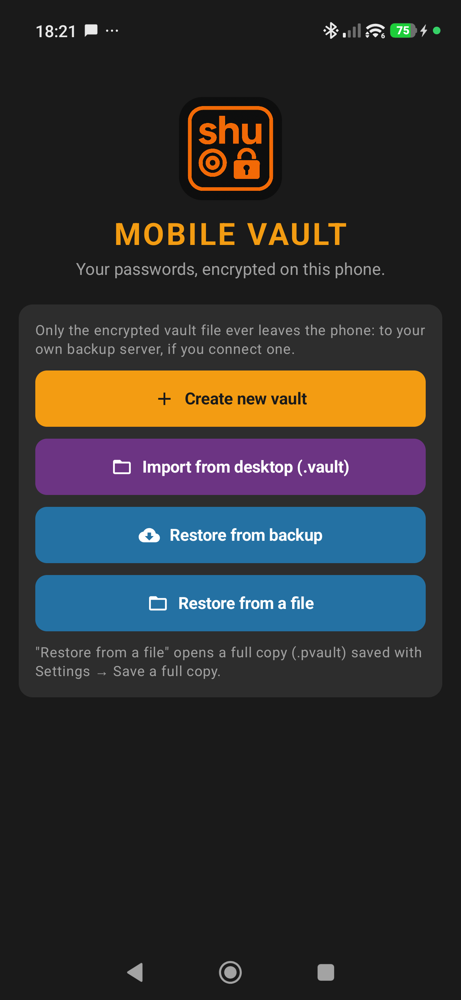
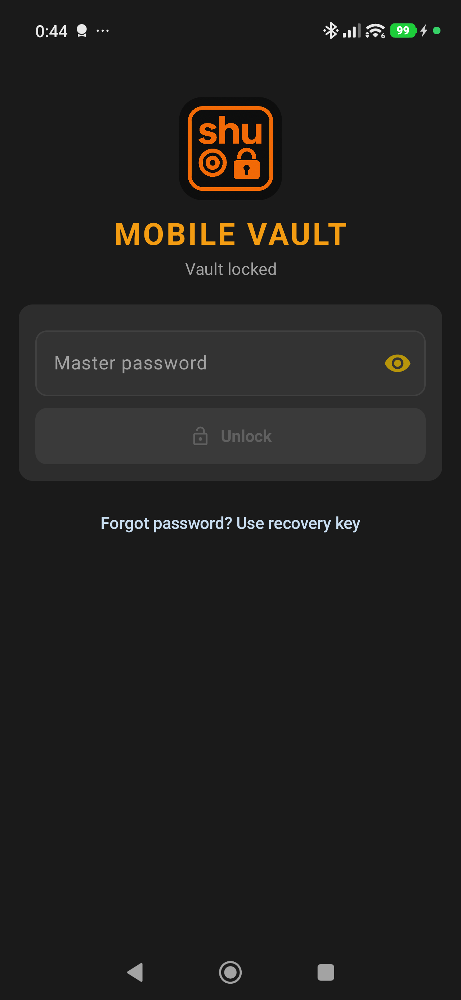
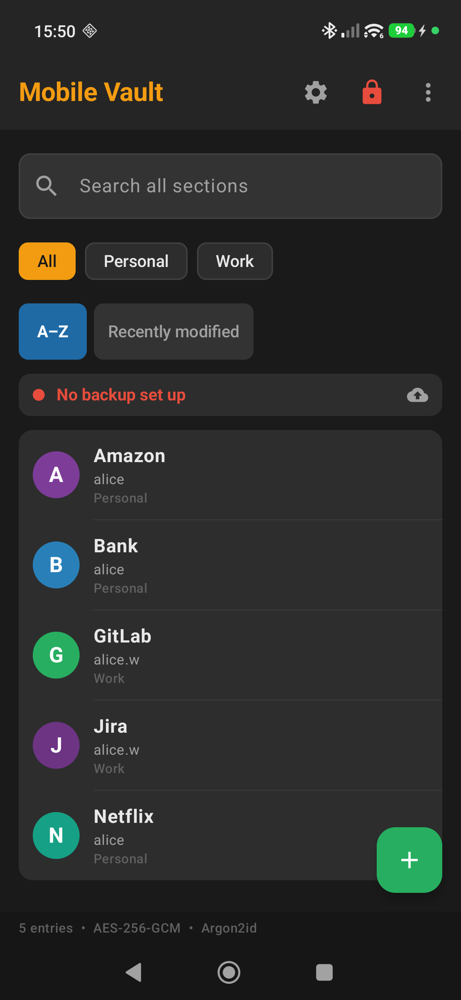
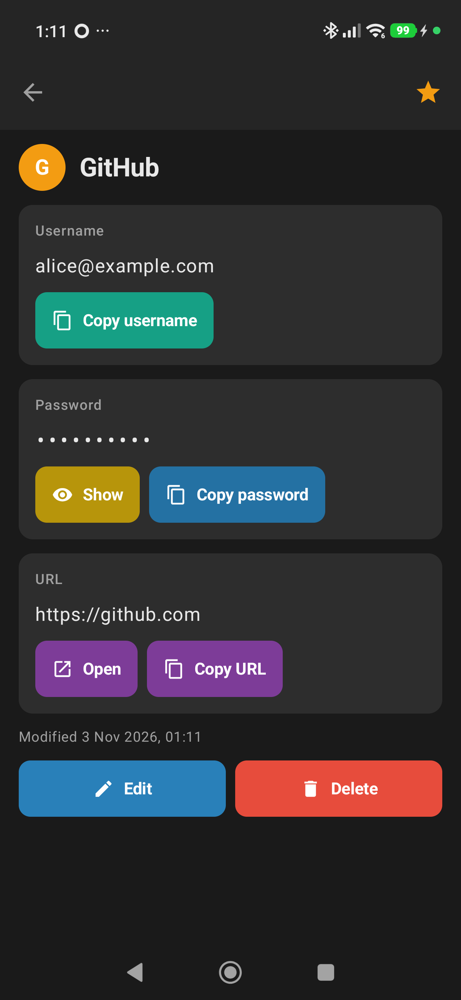
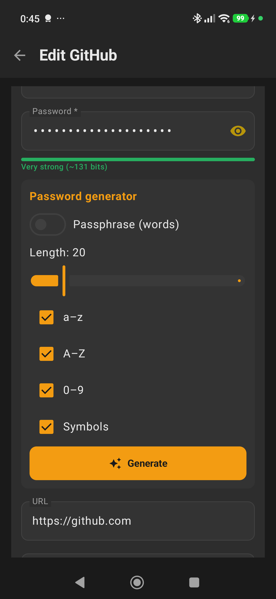
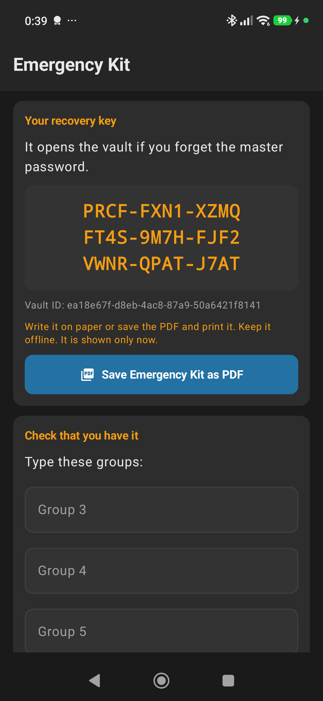

# Mobile Vault (Android)

An Android password vault based on **Shu PassVault** (desktop). It keeps the same strong offline encryption and adds protection against **losing** data: versioned, zero-knowledge remote backups to your own Ubuntu server, a master password hint and reminders, a recovery key for a forgotten master password, and local snapshot history.

## Screenshots
Debug build with test data (no real vault).

<table>
  <tr>
    <td align="center"> Welcome</td>
    <td align="center"> Unlock</td>
    <td align="center"> Entries and sections</td>
  </tr>
  <tr>
    <td align="center"> Entry details</td>
    <td align="center"> Password generator</td>
    <td align="center"> Emergency Kit</td>
  </tr>
</table>

More screenshots, by task: [`docs/screenshots/`](docs/screenshots/).

## Folder contents
| Path | What |
|---|---|
| `docs/HANDOFF.md` | **Start here**: state of the project, how we work, next steps |
| `docs/STATUS.md` | Progress and to-dos |
| `docs/DECISIONS.md` | Decisions made so far (licence, backup targets, password reminder) |
| `docs/CLAUDE_CODE_TASK_NN.md` | Tasks handed to the local Claude Code (01–04 done) |
| `docs/SERVER_CHECK.md` | Server state, hardening and backup-server deployment log |
| `docs/DESKTOP_APP_ANALYSIS.md` | How the desktop app works, the exact PVAULT1 file format, and weaknesses to fix |
| `docs/ANDROID_APP_SPEC.md` | Tech stack, features, security hardening, screens, milestones |
| `docs/VAULT_FORMAT_V2.md` | New file format: envelope encryption, recovery key, authenticated header, entry IDs |
| `docs/BACKUP_AND_RECOVERY.md` | Backup design: own-server HTTPS append-only API, retention, restore, conflicts, Emergency Kit |
| `android/` | Android project. `core-crypto` (M1, done): vault encryption library + tests; `tools/pvault2.py` Python reference |
| `server/` | Backup server (append-only HTTPS API), deploy files, smoke test |
| `reference/desktop-passvault/` | Copy of the desktop source, README, licence and screenshots (for UI reference) |
| `assets/` | App icon (`icon.png` 1.3 MB source and `icon.ico`); generate Android adaptive icons from `icon.png` |
| `test-vectors/` | Sample desktop-format vault + expected plaintext for unit tests |
| `tools/make_pvault1_sample.py` | Regenerates the sample vault (needs `pip install cryptography`) |

Licence: GPL-3.0 (inherited from the desktop app).
