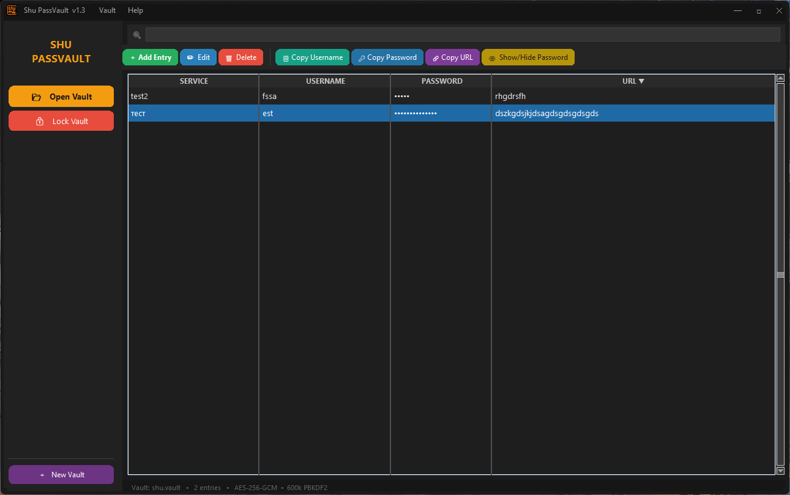
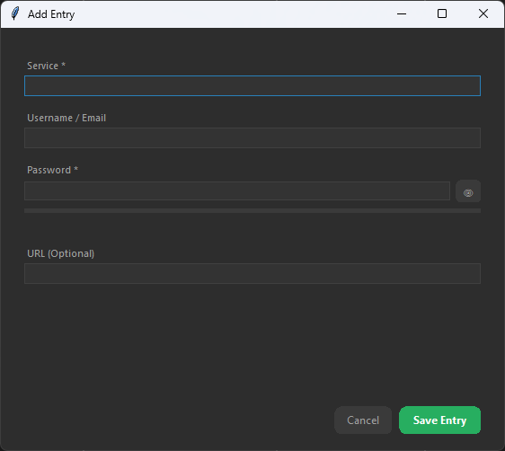
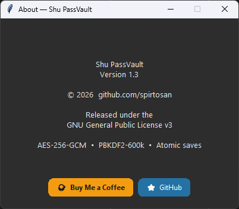

# Shu PassVault

[](https://www.gnu.org/licenses/gpl-3.0)
[](https://buymeacoffee.com/spirtosan)

A dark-themed, fully offline AES-256-GCM password manager for Windows — built with Python and Tkinter. No installation required.

---

## ✨ Features

| Feature | Detail |
|---|---|
| 🔐 **AES-256-GCM encryption** | Authenticated, tamper-proof |
| 🔑 **PBKDF2-SHA256 key derivation** | 600,000 iterations |
| 💾 **Atomic saves** | A crash mid-write cannot corrupt your vault |
| 🛡️ **Auto-lock** | Vault locks after 5 minutes of inactivity |
| 📋 **Clipboard auto-clear** | Password wiped after configurable timeout |
| 💾 **Auto-backup** | `.vault.bak` written on every successful save |
| 🔍 **Real-time search** | Filter all entries instantly |
| 🌙 **Custom dark UI** | Win32 titlebar (taskbar & Alt+Tab preserved) |
| 🖥️ **100% offline** | No network calls, no telemetry, no accounts |

---

## 📸 Screenshots

| Main Window | Add / Edit Entry | About |
|---|---|---|
|  |  |  |

---

## 🚀 Quick Start

### Option A — Download the exe *(Windows, no Python needed)*

Go to **[Releases](https://github.com/spirtosan/shu-pass-vault/releases)** and download `Shu PassVault.exe`.  
Run it — no installer needed.

### Option B — Run from source

```bash
git clone https://github.com/spirtosan/shu-pass-vault.git
cd shu-pass-vault
pip install -r requirements.txt
python password_manager.py
```

### Option C — Build the exe yourself

```bat
build.bat
```

The compiled exe appears in `dist\`.

---

## 📖 User Guide

### Creating your first vault
1. Click **＋ New Vault** (purple button, sidebar bottom).
2. Choose a save location and filename (e.g. `myvault.vault`).
3. Set a strong master password and confirm it.

### Adding entries
1. Click **＋ Add Entry** in the toolbar.
2. Fill in *Service* (required) and *Password* (required). Username and URL are optional.
3. Press **Enter** or click **Save Entry**.

### Copying credentials
- Select a row, then click **🔑 Copy Password** or **📋 Copy Username**.
- The password is automatically cleared from your clipboard after the configured timeout (default 30 s).
- Change the timeout: **Vault menu → Settings**.

### Searching
- Type in the search box at the top to filter entries in real time across Service, Username, and URL fields.

### Locking
- **🔒 Lock Vault** immediately wipes all data from memory.
- The vault also locks automatically after 5 minutes of inactivity.

### Changing your master password
- **Vault menu → Change Master Password…**

---

## 🔒 Security Notes

- Passwords are encrypted with **AES-256-GCM** before being written to disk.
- The master password never touches the disk — only its derived 256-bit key is used.
- Every save is **atomic**: you will never end up with a half-written file.
- A `.vault.bak` backup is written automatically on every successful save.
- The `.vault` file is safe to copy to cloud storage or a USB drive.

---

## 🛠️ Requirements (source / build)

- Python 3.10+
- `cryptography` ≥ 42
- `pillow` ≥ 10 *(build only, for icon conversion)*
- `pyinstaller` *(build only)*

---

## 📄 License

Copyright © 2026 [github.com/spirtosan](https://github.com/spirtosan)  
Released under the [GNU General Public License v3](LICENSE).

---

<a href="https://buymeacoffee.com/spirtosan" target="_blank">
  
</a>
